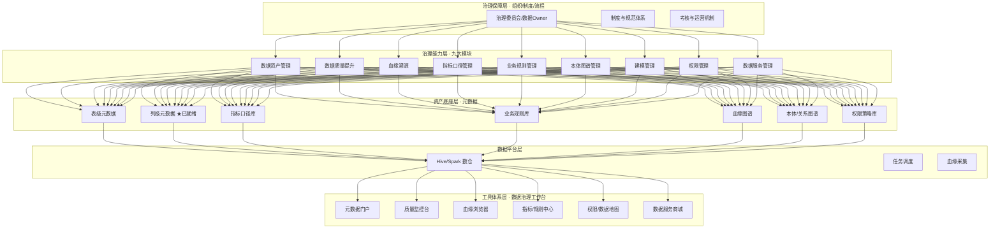

# 数据治理体系建设方案：蓝图与实施路径

> 基于数仓元数据（表信息表 + 血缘关系表 + **字段元数据表**）的现状分析，面向数据资产管理、数据质量提升、血缘溯源、指标口径管理、业务规则管理、本体图谱管理、建模管理、权限管理、数据服务管理九大领域，构建"制度—流程—标准—规范—工作台"五位一体的数据治理体系。

> **说明（V2 更新）**：本次在原有表信息、血缘关系基础上，新增了**字段（列）级元数据**（xxx 个字段、覆盖 xxx 张表）。这补全了上一版识别的"列级元数据缺失"这一最大短板，同时暴露了新的、更精细的治理重点（列注释缺失、字段级血缘未建、敏感字段未打标、字段类型不规范等）。本版方案基于新增数据做了系统性更新。

---

## 一、元数据现状分析（数据基础）

本节结论均基于已提供的三份元数据表（`表信息表` xxx 条、`血缘关系表` xxx 条、`字段元数据表` xxx 条）的实际分析得出。

### 1.1 数据资产总览

| 维度 | 现状 | 说明 |
|---|---|---|
| 表资产总量 | xxx 张表 | 全部为 MANAGED_TABLE（托管表） |
| 技术平台 | SparkThrift/Hive | 统一 Spark 生态 |
| 存储格式 | orc(xxx)、parquet(xxx)、text(xxx)、缺失(12) | 格式不统一，text 表占比约 21% |
| 业务租户 | 4 大租户 | 财务类(xxx)、通用类(xxx)、人力类(xxx)、审计类(14) |
| 业务库（项目） | xx 个库 | 以 `proj_*` 项目库为主 |
| 数据分层 | 见 1.2 | ODS/DWD/DWS/ADS/DIM/STG/TMP + 非规范命名 |

### 1.2 分层结构

按表名前缀识别到的分层分布：

| 分层 | 表数量 | 占比 |
|---|---|---|
| ODS（贴源层） | xxx | 22.9% |
| DWD（明细层） | xxx | 8.3% |
| DWS（汇总层） | xxx | 3.2% |
| ADS（应用层） | xxx | 8.0% |
| DIM（维度层） | xxx | 4.6% |
| STG（临时/缓冲） | xx | 0.6% |
| TMP（临时） | xx | 1.0% |
| **非规范命名** | **xxx** | **51.4%** |

> **关键发现①：命名规范缺口大。** 超过一半的表（xxx 张）不符合标准分层前缀规范，其中 xxx 张集中在 `proj_cdc_fund_data_prod`（如 `dm_funds_*`、`t_dtinsight_*`、`mail_*` 等历史遗留命名）。这直接影响资产检索、血缘链路和权限策略的自动识别。

### 1.3 血缘关系现状

| 维度 | 现状 | 说明 |
|---|---|---|
| 血缘总条数 | xxx 条 | lineage_type: 0(表级血缘) xxx / 1(字段级/自引用) xxx |
| 涉及源表 | xxx 张 | 唯一源表 |
| 涉及目标表 | xxx 张 | 唯一目标表 |
| 涉及项目（schema） | xx 个 | 与 xx 个业务库存在覆盖差 |
| 血缘-资产覆盖 | 表信息命中源表名 100% / 目标表名 100% | 按 table_id 命中仅 ~15% |

> **关键发现②：血缘覆盖严重不足。** xxx 张表中，**约 94.8%（xxxx 张）无任何血缘记录**，即血缘仅覆盖约 xxx 张源表 / xxx 张目标表。已捕获血缘基本沿标准分层（ODS→DWD→DWS→ADS）正向流转，但大量表（尤其非规范 ODS 与其他层）尚未纳入血缘采集。
>
> **关键发现③：血缘 id 关联断裂。** 血缘表通过 `table_id` 关联表信息时命中率仅约 15%，而按 `table_name` 关联命中率 100%——说明血缘关系当前主要靠**表名**关联，`table_id` 未做统一外键收敛。这会导致资产目录与血缘图谱之间存在"同名不同 ID"的隐患，必须在治理落地时做 ID 归一。
>
> **关键发现③-附：字段级元数据为字段级血缘提供了落点，但字段级血缘尚未采集。** 血缘关系表（xxx 条）目前仍是**表级**血缘，未包含列级关系；而字段元数据表已具备 xxx 个字段的 column_name 定义。这为**字段级血缘的采集与解析**（如按同名列、JOIN 键推断列级依赖，进而支撑 ODS→DWD→DWS→ADS 字段级溯源与影响分析）提供了直接的基础，是血缘溯源从"表级"升级到"字段级"的关键前提。

### 1.4 主要数据质量与治理缺口（基于元数据字段缺失）

| 元数据字段 | 缺失率 | 治理影响 |
|---|---|---|
| table_comment（表注释） | 55.2% | 资产无法被检索和理解，需建立注释补全机制 |
| column_comment（字段注释） | 50.7% | 字段口径难以理解，影响指标与业务规则落地 |
| db_comment（库注释） | 55.2% | 业务目录难以建立 |
| partition_newest（最新分区） | 52.0% | 分区管理/增量监控缺失 |
| table_rec_count（记录数） | 100%（全空） | 无法做数据量监控、健康度评估 |
| table_life_day（生命周期） | 基本齐全 | xxx 张永久保留、xxxx 张短周期(≤10天)、xxx 张月度、xxx 张年级 |
| table_size / file_count | 51.8% 为 0 / 1,453 张 file_count=0 | 存在"孕空/未产数"表风险 |

> **关键发现④：字段级元数据已基本具备，但质量参差。** 相比上一版（列级元数据完全缺失），本次新增的字段元数据表已覆盖 **xxx 张表（匹配率 100%）、共 xxx 个字段**，每表平均约 22.7 列。这为字段级血缘、指标口径、本体图谱、字段级权限和数据服务提供了基础。但仍有明显短板：
> - 字段注释缺失率 **50.7%**，且主要集中于非规范库（`proj_cdc_fund_data_prod` 注释覆盖仅约 13%）与 OTHER 层（仅约 2%），而标准层（ADS/DWS/DWD/DIM）注释覆盖已达 90%+；
> - 字段类型偏 `string`（约 76%），大量本应数值化的字段用字符串承载，**类型规范亟待收敛**；
> - **敏感字段尚未打标**，经关键词启发式识别疑似敏感字段约 **xxx 个**（手机号、姓名、身份证、金额、工资等），需建立敏感分级规范并落地字段级权限。

### 1.5 字段级元数据专项分析（新增）

基于新增的 `字段元数据表`（xxx 条字段记录）统计：

**（1）覆盖度**
| 维度 | 数值 | 说明 |
|---|---|---|
| 覆盖字段记录 | xxx | 含 column_name / column_comment / column_type |
| 覆盖表数 | xxx | 与表信息表匹配率 100% |
| 平均每表字段数 | 约 22.7 | 单表最多 xxx 列 |

**（2）字段注释覆盖（总体 49.3%，分层差异大）**
| 分层 | 字段数 | 注释覆盖 |
|---|---|---|
| ADS | xxx | 97.7% |
| DWS | xxx | 96.5% |
| DIM | xxx | 95.8% |
| DWD | xxx | 93.9% |
| STG | xxx | 87.8% |
| TMP | xxx | 84.5% |
| ODS | xxx | 72.9% |
| **OTHER（非规范）** | **xxxxx** | **约 2.4%** |

> **重点：字段注释的"洼地"集中于非规范库。** 其中 `proj_cdc_fund_data_prod` 字段数最多，但字段注释覆盖仅约 13.6%；而 `proj_cdc_common_main_prod`、`proj_cndcap_invmgtsys_prod`、`proj_hr_data_*`、`proj_cdc_fin_data_warehouse_prod` 等标准库注释覆盖已达 80%-99%。字段注释补全应优先聚焦非规范 ODS 与 OTHER 层。

**（3）字段类型现状**
| 类型 | 数量 | 说明 |
|---|---|---|
| string | xxxxx | 占比约 76% |
| int / bigint | xxxxx | |
| decimal（多种精度） | xxxx | decimal(38,4)/decimal(30,6)/decimal(36,2) 等 10 余种精度并存 |
| timestamp / date | xxxx | |

> **重点：类型规范需收敛。** 约 76% 字段为 string，大量数值型字段由字符串承载；同时 decimal 精度 10 余种并存。需在治理标准中统一"数值/金额/日期/枚举"字段类型与 decimal 精度规范，前端支撑指标计算与数据服务 Schema 一致性。

**（4）敏感字段与指标字段线索（治理抓手）**
- 疑似**敏感字段约 xxxx 个**（按手机号、姓名、身份证、银行卡、密码、邮箱、地址、金额、工资、信用等识别），是字段级权限与数据分级的第一批落点；
- 疑似**指标型字段约 xxxx 个（涉及 xxx 张表）**（注释含"率/占比/金额/余额/净额/总额/平均"等），是**指标口径库**建设的天然候选输入。

### 1.6 现状诊断小结（SWOT 式）

- **优势**：已建立基础表资产登记与表级血缘采集能力；**字段级元数据已具备（xxx 字段、覆盖全部表）**；分层体系已具雏形；已有租户分类与项目库概念。
- **劣势**：非规范表占比过半（51.4%）；血缘覆盖不足 6% 且仍为表级（字段级血缘未采）；字段注释缺失 50.7%（集中于非规范库）；字段类型以 string 为主、decimal 精度混乱；表注释/分区/记录数等基础质量字段缺失严重；敏感字段未打标。
- **机会**：可借治理体系一次性补全命名、字段级血缘、敏感打标、指标口径，形成可复用的统一资产底座；字段元数据 + 指标型字段可直接支撑指标口径库建设。
- **威胁**：表数量大(xxx)且随时间增长，若不做治理，血缘断裂、口径混乱、权限失控风险将持续放大。

---

## 二、数据治理体系总体蓝图

### 2.1 治理目标

围绕"**管得住、找得到、信得过、用得活**"的十六字目标：

- **管得住**：统一元数据、权限、生命周期与命名规范，全域可管可控；
- **找得到**：建立可检索的数据资产目录，业务口径可理解；
- **信得过**：数据质量可度量、可追溯，指标口径唯一可信；
- **用得活**：通过数据服务与自助分析，让数据价值流动起来。

### 2.2 总体架构（分层蓝图）

---

## 三、九大治理领域蓝图与实施方案

> 每个领域按下述结构展开：**建设目标 → 核心能力 → 制度/流程 → 标准/规范 → 在"数据治理工作台"中的落地 → 分阶段实施要点**。

### 3.1 数据资产管理

**建设目标**：将 xxx 张表建设为**可检索、可理解、可定级**的资产目录。

**核心能力**：
- 资产自动采集（元数据同步）与增量更新；
- 资产分级分类（主题域 / 业务域 / 分层 / 质量等级 / 敏感等级）；
- 资产标签与搜索、资产生命周期与下线管理、资产Owner认领。

**制度与流程**：
- 《数据资产登记与变更管理制度》：新增/变更/下线表需在目录登记并维护注释、Owner、业务域；
- 资产上线评审流程、资产下线/归档评审流程。

**标准与规范**：
- **命名规范（优先整改）**：统一 `层_业务域_主题_粒度[_增量|全量]` 命名，例如 `dws_fund_loan_daily_df`。推动xx张非规范表分批重命名映射；
- 表注释覆盖率 ≥ 95%，库注释 100%，字段注释 100%（现状 49.3%，需优先补非规范库：fund 库仅约 13.6%）；
- **字段类型规范**（收敛 string 承载数值与 decimal 精度并存问题，当前 string 占比约 76%）；
- 资产定级规范（L1-L4 敏感等级）。

**工作台落地**：元数据门户、资产360°视图、资产检索、模板化资产卡片。

**分阶段**：
- P1：命名规范发布 + 资产目录建设 + 注释补全"空表/空字段清单"生成（含字段注释缺失清单，优先非规范库）；
- P2：历史非规范表分批重命名与血缘重映射 + 字段注释与字段类型专项整改；
- P3：资产评级、生命周期自动化、资产下线流程上线。

---

### 3.2 数据质量提升

**建设目标**：建立**可度量、可监控、可告警、可治理**的数据质量体系。

**核心能力**：
- 质量规则（完整性/准确性/唯一性/一致性/及时性/有效性）配置与执行；
- 六大维度质量打分与质量报告；
- 质量告警、问题工单、整改闭环；
- **对照现状**：补齐 `record_count`（当前 100% 缺失）、`partition_newest`、`size/file_count`（大量为 0）等基础监控字段。

**制度与流程**：
- 《数据质量管理办法》：质量责任人、问题分级（P0/P1/P2）、整改时限；
- 质量巡检流程、质量问题工单闭环流程。

**标准与规范**：
- 质量规则模板库；
- 质量评分模型（按表/按字段/按指标计分）；
- 阈值规范（如 ODS/DWS/ADS 及时性 SLA）。

**工作台落地**：质量规则编排台、质量看板、问题工单中心、质量报告。

**分阶段**：
- P1：补全基础监控字段、建立核心表（ADS/DWS 关键表）质量规则；
- P2：全量表质量扫描、打分体系上线；
- P3：质量与血缘/权限联动（低质量表降级访问）、问题闭环运营。

---

### 3.3 血缘溯源

**建设目标**：构建**端到端、可追踪、可影响分析**（上游溯源 + 下游影响）的血缘图谱，支持"数据从哪来、用到哪、改表影响谁"。

**核心能力**：
- 表级血缘 + **字段级血缘**（字段元数据已就绪 xxx 字段，为字段级血缘采集/解析提供落点）；
- 全链路血缘（源系统→ODS→DWD→DWS→ADS→报表/服务）；
- 血缘分叉/合并/自引用识别（已观测到 xxx 条自引用血缘，其中 xx 条为类型 1）；
- **现状映射**：已捕获表级血缘 xxx 条，但需扩展到 xxx 张全量表（当前仅覆盖 ~6%）；字段级血缘尚未采集。

**制度与流程**：
- 《血缘采集与维护规范》：新建表/任务必须自动登记上游血缘；
- 血缘断链治理流程、影响分析发布流程。

**标准与规范**：
- 血缘采集范围与粒度（表级必采、字段级推荐）；
- 血缘标签标准（lingeage_type 0/1 的口径统一）；
- 血缘完整度指标（有血缘表占比、链路完整度、字段级血缘覆盖）。

**工作台落地**：血缘浏览器（上游/下游/全链路/字段级）、影响分析、断链清单。

**分阶段**：
- P1：表级血缘全量补采（从 6% → ≥90% 有血缘）+ **table_id 归一**（修复以 name 关联、id 断裂问题）；
- P2：基于已就绪的字段元数据，落地**字段级血缘**采集（按同名列/JOIN 键解析列级依赖），升级溯源与影响分析粒度；
- P3：字段级血缘覆盖纳入考核、影响分析自助化、字段级下游影响告警。

---

### 3.4 指标口径管理

**建设目标**：建立**唯一可信**的指标口径库，解决"同名不同义、同义不同名"问题，支撑跨项目口径一致。

**核心能力**：
- 指标字典（指标名、口径说明、计算公式、取数逻辑、适用分层表/字段、负责人）；
- 指标版本管理与变更审批；
- 指标血缘（指标→表/字段映射）；
- 指标口径冲突检测；
- **现状映射**：从字段元数据中已识别疑似**指标型字段约xxx个**（注释含"率/占比/金额/余额/净额/总额/平均"等），可作为指标口径库建设的**第一批候选输入**，显著降低从零梳理成本。

**制度与流程**：
- 《指标口径管理办法》：指标新增/变更评审、口径冻结与发布、口径责任人；
- 指标口径变更影响评估流程。

**标准与规范**：
- 指标命名与编码规范、口径模板；
- 指标口径"一人一责"、口径可用级（C1 正式 / C2 试用 / C3 废弃）。

**工作台落地**：指标中心（指标搜索、口径详情、版本历史、变更评审）、指标血缘。

**分阶段**：
- P1：以xxxx个疑似指标型字段为**种子**，结合 4 大租户业务域（财务、投资、人力、风控）评审，建立 C1 正式级核心指标字典；
- P2：指标→字段血缘打通、口径变更影响分析、同步补全缺失的字段注释；
- P3：指标口径与质量、权限、服务联动，全量指标字典化。

---

### 3.5 业务规则管理

**建设目标**：将散落于代码/文档的业务规则（校验、清洗、映射、预警）**显式化、可复用、可审计**。

**核心能力**：
- 业务规则库（规则定义、适用表/字段、生效状态）；
- 规则版本管理、规则与血缘/质量联动（如"逾期 90 天应收"口径即业务规则）；
- 规则引擎接入（规则校验、规则告警）。

**制度与流程**：
- 《业务规则管理办法》：规则登记、评审、发布、停用；
- 规则变更影响评估。

**标准与规范**：
- 规则分类（标准化规则/质量规则/口径规则/风控规则）；
- 规则命名与编码规范。

**工作台落地**：规则中心、规则-表/指标绑定、规则运行监控。

---

### 3.6 本体图谱管理

**建设目标**：建立企业**数据本体/实体关系图谱**，让"业务对象（人、机构、项目、合同、基金……）× 数据表 × 指标"形成可导航的知识网络。

**核心能力**：
- 业务本体建模（实体、属性、关系）；
- 实体↔表映射（如"借款合同"映射到相关 ODS/DWD 表）；
- 知识图谱检索与导航（基于血缘 + 本体）。

**制度与流程**：
- 《本体建模规范》：业务实体/关系建模评审；
- 本体变更与维护机制。

**标准与规范**：
- 本体建模语言与元素规范（实体、关系、约束）；
- 实体-表映射规范。

**工作台落地**：本体建模器、知识图谱浏览器、实体卡片。

**分阶段**：
- P1：选定 2-3 个核心业务域（如投资、财务、人力）试点本体建模；
- P2：本体与血缘融合，形成"实体-数据-指标"知识网络；
- P3：全量业务域扩展 + 图谱驱动自助取数导航。

---

### 3.7 建模管理

**建设目标**：规范数仓模型设计，提升分层一致性与可维护性（对齐标准分层 ODS/DWD/DWS/ADS/DIM）。

**核心能力**：
- 分层建模规范落地与校验（当前 51.4% 非规范命名需整改）；
- 模型评审（关系、维度建模、命名、字段规范）；
- 数据模型登记与版本管理、模型与物理表映射。

**制度与流程**：
- 《数仓建模规范》与《模型评审制度》：新建模型须评审通过；
- 模型变更与收敛流程。

**标准与规范**：
- 分层定义与职责边界标准；
- 表命名、字段命名、主外键规范；
- **字段类型规范（本次重点）**：统一"数值/金额/日期/枚举/BigInt"类型映射，收敛 string 承载数值、decimal 精度 10 余种并存的现状；对本应数值化的 string 字段与 decimal 精度做规范化改造；
- 维度建模（星型/雪花）与宽表设计规范。

**工作台落地**：建模规范检查工具（含字段类型/命名自动校验）、模型评审台、模型-物理表映射关系。

**分阶段**：
- P1：发布分层与命名规范 + **字段类型规范**，建自动校验（命名合规率、decmal 精度规范纳入考核）；
- P2：关键域（fund/common/hr）非规范表重命名与模型重构，同步做字段类型整改；
- P3：模型评审线上化、模型血缘与规范联动检查。

---

### 3.8 权限管理

**建设目标**：实现**最小权限、职责分离、可审计**的数据访问控制。

**核心能力**（字段元数据已就绪，字段级权限具备数据基础）：
- 库/表级权限 + **字段级（敏感列）权限**；
- 行列级数据权限（如租户/渠道范围）；
- 权限申请-审批-授权-回收全流程、权限审计与最小权限治理；
- **现状映射**：字段元数据已覆盖全部表，可据此进行**敏感字段打标**——关键词启发式已识别疑似敏感字段约 **xxxxx 个**（手机号、姓名、身份证、银行卡、密码、邮箱、地址、金额、工资、信用等），作为字段分级（L1-L4）的第一批对象。

**制度与流程**：
- 《数据权限管理办法》：权限分级、申请审批流程、越权与泄露应急；
- 权限定期复核（每季度）。

**标准与规范**：
- 敏感数据分级（L1-L4）与字段打标；
- 权限矩阵（角色-对象-操作）；
- 租户数据隔离规范（财务/人力/审计/通用四类租户互访边界）。

**工作台落地**：数据地图权限视图、权限申请门户、审批流、权限审计报表。

**分阶段**：
- P1：以 xxxxx 个疑似敏感字段为基础做分级打标（先审核心库），同时库表级权限梳理与收敛（排查"宽权限"）；
- P2：字段级权限上线（敏感列脱敏/授权拦截）；
- P3：行列级权限、权限自动回收与审计自动化。

---

### 3.9 数据服务管理

**建设目标**：把可信数据以**服务化**方式对外输出（API / 数据订阅），统一出口、可监控、可计费追责。

**核心能力**：
- 数据服务编排（将 ADS/主题数据封装为服务）；
- 服务目录、版本管理与权限控制；
- 调用监控、SLA 保障、日志审计。

**制度与流程**：
- 《数据服务管理办法》：服务上线评审、版本发布、下线流程；
- 服务调用方管理机制。

**标准与规范**：
- 服务命名、版本、接口规范；
- 服务 SLA 与数据交付规范。

**工作台落地**：数据服务商城、服务监控、接口文档。

---

## 四、体系"五位一体"设计（制度·流程·标准·规范·工作台）

### 4.1 制度体系（治理的组织与规则上位法）

| 制度 | 定位 | 覆盖领域 |
|---|---|---|
| 《数据治理章程》 | 治理总纲、组织架构、决策机制 | 全局 |
| 《数据资产登记与变更管理制度》 | 资产全生命周期 | 资产管理 |
| 《数据质量管理办法》 | 质量责任、问题分级与闭环 | 质量 |
| 《血缘采集与维护规范》 | 血缘采集责任与断链治理 | 血缘 |
| 《指标口径管理办法》 | 指标口径唯一性与变更管控 | 指标口径 |
| 《业务规则管理办法》 | 规则显式化与复用 | 业务规则 |
| 《本体建模规范》 | 本体建模与维护 | 本体图谱 |
| 《数仓建模规范》《模型评审制度》 | 分层与模型设计 | 建模 |
| 《数据权限管理办法》 | 分级授权与审计 | 权限 |
| 《数据服务管理办法》 | 服务化交付与监控 | 数据服务 |

### 4.2 治理组织（责任体系）

- **数据治理委员会**：决策、资源、跨域协调；
- **数据Owner（领域Owner）**：分业务域（投资/财务/人力/风控/审计）认领资产与指标；
- **数据管家（Steward）**：日常元数据、质量、血缘维护；
- **平台团队**：元数据采集、工具平台实现；
- **治理运营组**：考核、培训、合规审计。

### 4.3 标准体系（技术口径）

- 数据分类分级标准（L1-L4）；
- 命名与编码标准（表、字段、指标、规则）；
- 数据质量六大维度标准与评分模型；
- 生命周期保留策略标准（对齐现状的 10 天/30 天/季度/年度/永久分级）；
- 分层与模型设计标准。

### 4.4 规范体系（操作细则）

- 表/字段注释撰写规范；
- 血缘登记与字段级血缘采集规范；
- 指标口径描述模板；
- 业务规则登记模板；
- 权限审批与敏感字段打标操作规范；
- 数据服务协议（SLA/接口）模板。

### 4.5 数据治理工作台（落地载体）

面向不同角色提供统一工作台：

| 模块 | 功能 | 对应领域 |
|---|---|---|
| 元数据门户/资产地图 | 资产搜索、360°视图、标签、Owner | 资产管理 |
| 质量监控台 | 规则、看板、告警、工单 | 质量 |
| 血缘浏览器 | 上/下游、影响分析、断链清单 | 血缘 |
| 指标中心 | 指标字典、版本、变更评审 | 指标口径 |
| 规则中心 | 规则登记与运行 | 业务规则 |
| 本体建模器/知识图谱 | 实体-数据-指标导航 | 本体图谱 |
| 建模工具/评审台 | 模型规范校验与评审 | 建模 |
| 权限中心/数据地图 | 申请、审批、敏感列审计 | 权限 |
| 数据服务商城 | 服务发布、订阅、监控 | 数据服务 |
| 治理驾驶舱 | 覆盖率/质量/血缘/合规一屏总览与考核 | 全局运营 |

---

## 五、分阶段实施路线图

> 建议整体按"**打基础（P1）→ 提能力（P2）→ 见成效（P3）**"三段推进，每阶段 3-5 个月。

### 阶段 P1：统一底座（0-3 个月）
- 发布《数据治理章程》、治理组织与十大制度框架；
- 搭建治理工作台框架（元数据门户 + 资产目录）；
- **依托已就绪的字段级元数据**（xxx 字段、覆盖 xxx 表）补齐字段管理与质量短板：字段注释补全（重点非规范库/fund 库 13.6%）、字段类型规范化（收 string 承载数值、decimal 精度）；
- 表/库/字段注释补全（生成"待补清单"，覆盖目标 ≥95%）；
- 血缘表级全量补采 + **table_id 归一**修复；
- 命名规范发布并配套自动校验；
- 质量基础监控字段补全（record_count、partition、size）。

**P1 交付**：治理章程与制度 1.0、资产目录上线、字段级元数据纳入资产管理、字段注释/类型整改启动、血缘覆盖 ≥90%、命名合规检查上线。

### 阶段 P2：核心能力（4-8 个月）
- 关键域（财务类/投资类/人力类）标准化重命名与模型收敛；
- 质量评分与告警、问题闭环上线；
- 指标字典建设（C1 正式级关键指标）、字段级血缘；
- 敏感字段打标 + 字段级权限、权限收敛审计；
- 本体建模试点（2-3 核心业务域）；
- 数据服务商城（首个 ADS 服务上线）。

**P2 交付**：质量看板与打分体系、指标中心、字段级权限、本体试点、首个数据服务发布。

### 阶段 P3：深化运营（9-12 个月）
- 全量业务域扩展（含四类租户数据隔离落实）；
- 指标口径与质量/权限/服务全联动；
- 血缘完整度、口径唯一性、质量评分纳入考核与驾驶舱；
- 数据生命周期自动化（下线/归档）；
- 持续运营机制（季度治理评审、培训、合规审计）。

**P3 交付**：治理驾驶舱、考核体系、全量本体图谱、数据服务规模化、可持续运营机制。

---

## 六、实施保障与风险防范

| 保障/风险 | 应对措施 |
|---|---|
| 组织保障 | 明确委员会 + 数据Owner + 管家三级责任，治理纳入绩效 |
| 数据/标准保障 | 字段级元数据已就绪，标准先行、先立后破，聚焦字段注释/类型/敏感打标整改 |
| 存量表整改风险 | xxxx 张非规范表分批重命名，先建立"新旧映射+血缘重挂"机制再动表，避免断裂 |
| 血缘ID断裂 | P1 即做 table_id 归一双向关联，杜绝"同名不同ID" |
| 字段敏感度误判 | 分类分级评审 + 抽样校验 + 权限审计兜底 |
| 落地阻力 | 试点先行（选投资/财务/人力高价值域），用"见效案例"推动全量推广 |
| 平台依赖 | 元数据采集与血缘/质量工具优先工具化，人工维护降到最低 |

